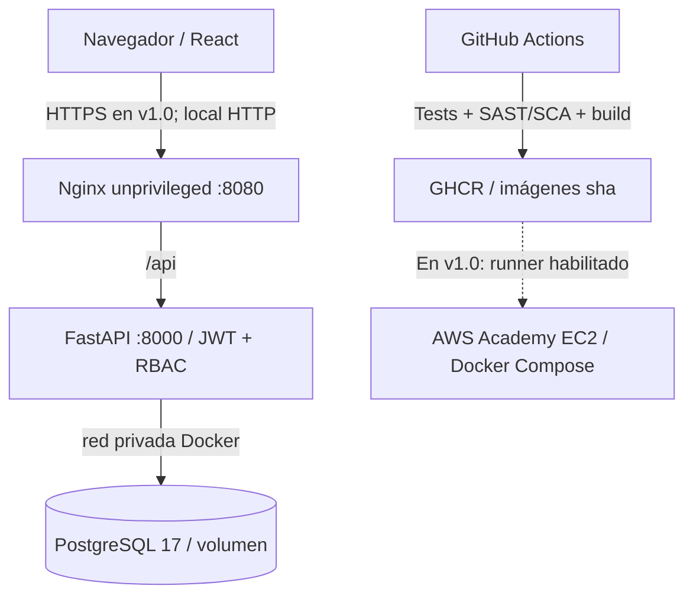
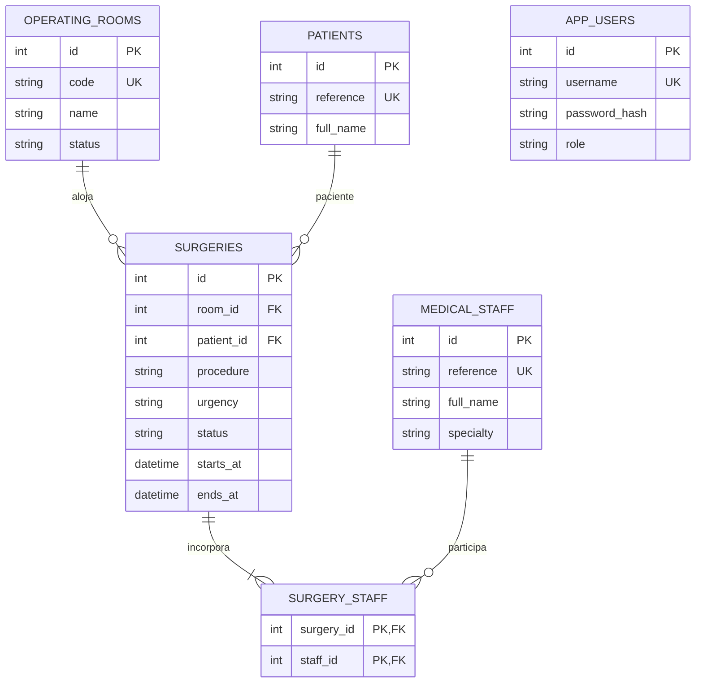

# Arquitectura y modelo de datos de MediNet PAB

La aplicación bloquea los recursos involucrados con `pg_advisory_xact_lock` en orden consistente dentro de una transacción, comprueba los solapamientos y luego escribe la cirugía. El control de acceso exige JWT y rol admin/coordinator en endpoints mutables; viewer solo consulta. `patients` y `medical_staff` son **simulaciones** hasta integración con otros equipos de MediNet-Core.
