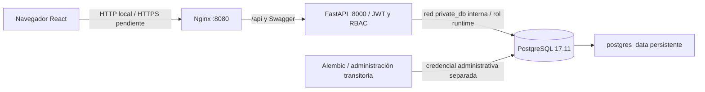

# Entrega técnica MediNet PAB v0.5 — Matías Gubelin

Fecha: 30-10-2026, America/Santiago. Evaluación 2, Desarrollo Seguro.
Repositorio existente: https://github.com/claudiopioEnfasis/medinet-pab
Rama revisada: `main`; HEAD de partida: `a1d0b4c`. No se hizo commit ni push.

## 1. Estado de la entrega

| Ámbito | Implementado | Verificado en esta revisión | Pendiente |
|---|---|---|---|
| API, JWT/RBAC, validaciones | Sí | 60 pruebas, sin omisiones; PostgreSQL real | Integración con IAM/PAC/MED reales |
| Concurrencia | Bloqueos por sala/paciente/profesional y fila | Reservas, inicios, transiciones y login concurrentes | Mantener estos bloqueos en todo nuevo escritor |
| PostgreSQL mínimo privilegio | Rol runtime y mantenimiento separados | Copia y original: ocho denegaciones; consultas y escritura verificada | Mantener grants en cambios futuros |
| Credenciales | Runtime aleatorio en archivo separado | SCRAM y permisos en el entorno original | Rotar la credencial administrativa débil con actualización privada coordinada |
| React | Diseño conservado; ajustes móviles puntuales | Chromium, tres roles, 320/390/768 px; frontend actualizado localmente | Sin defectos funcionales pendientes detectados |
| Docker | Tres servicios normales y mantenimiento transitorio | Builds, restauración, copia limpia y tres servicios locales saludables | Operación y verificación remota en EC2 |
| CI/CD | Build, Test, Security Scan, publicación, Deploy EC2 | actionlint y controles locales | Ejecuciones reales de GitHub Actions y AWS |
| Producción | Composición por SHA y DB privada | Validación local de configuración | TLS, SG, respaldo externo, runner y prueba externa |

La instalación original ya usa `medinet_runtime`: cambio aplicado con autorización
y respaldo fresco restaurado/verificado. API/web se actualizaron y los tres
contenedores están saludables; DB no se reinició. Las cuentas y contraseñas
preexistentes y todos los registros se conservaron. `.env.runtime` existe con
permisos 0600; `.env` y JWT permanecen idénticos.
Ver [plan aplicado](PLAN_POSTGRES_V05.md) y
[informe completo](AUDITORIA_INTEGRAL_V05.md).

## 2. Arquitectura y tecnologías



Nginx sirve los estáticos y redirige `/api/` al backend. `API_ROOT_PATH=/api`
permite que Swagger invoque la API a través del proxy. La API pertenece a las
redes `front` y `private_db`; web únicamente a `front`; DB únicamente a
`private_db`, que tiene `internal: true`. PostgreSQL no publica puertos.
API/web usan loopback en desarrollo. La composición de producción publica
solo web en loopback, para un futuro proxy TLS del host.

- Python 3.12, FastAPI 0.162.0, Starlette 1.10.0, Uvicorn 0.48.0.
- SQLAlchemy 2.0.50, psycopg 3.3.6, Pydantic 2.13.5, Alembic 1.18.4.
- PyJWT 2.15.1 / HS256; Argon2id mediante argon2-cffi 25.1.0.
- React/ReactDOM 19.2.0, Vite 7.3.7, Node 22 para compilar, Nginx 1.30 para servir.
- PostgreSQL 17.11 Alpine; imagen derivada con auxiliar gosu recompilado.
- Pytest 9.0.3, HTTPX, Bandit, pip-audit, npm audit, Trivy, actionlint y ShellCheck.
  Playwright/Chromium son opcionales para el ensayo del navegador.

Las imágenes base se fijan por digest. Las actualizaciones Alpine durante el
build hacen que su resultado también dependa del catálogo disponible; el pipeline
conserva y publica **las mismas imágenes que se escanearon**, sin reconstruirlas.

### Estructura

```text
app/                    API, ORM, esquemas, autenticación y bloqueos
frontend/src/           React, cliente HTTP, componentes y estilos
frontend/nginx.conf     Proxy, CSP, límites HTTP y rate limit de login
migrations/             Alembic; revisión inicial 0001
scripts/                Migración, usuarios, seed, grants y respaldo
tests/                  Suite unitaria, PostgreSQL real y smoke de navegador
docs/                   Entrega, auditorías y evidencias publicables
.github/workflows/      CI/CD, publicación GHCR y entrega EC2 condicionada
compose.yaml            Desarrollo; volumen persistente
compose.prod.yaml       Imágenes GHCR por SHA; sin build en EC2
Dockerfile*             Construcciones backend y PostgreSQL
.env.example            Plantilla sin secretos utilizables
```

## 3. Instalación desde GitHub y variables

Matías requiere acceso al repositorio privado, Git, Docker Engine/Compose v2
reciente, Bash, OpenSSL y Python 3 en el host. Node/Python de desarrollo no son
necesarios para ejecutar la aplicación con Docker. Se probó Linux/AMD64.

Seguir el [README](../README.md): clonar en una carpeta nueva **solo para una
instalación nueva**, crear `.env` con noclobber y permisos 0600, completar valores
privados, construir, migrar, respaldar, provisionar runtime y levantar servicios.
No reinicializar Git ni clonar sobre la instalación existente.

| Archivo / variable | Uso | Tratamiento |
|---|---|---|
| `.env`: POSTGRES_USER | Administrador/propietario de BD | Conservar en volúmenes existentes |
| `.env`: POSTGRES_PASSWORD | Contraseña administrativa | Aleatoria en nuevas instalaciones; rotación existente pendiente |
| `.env`: POSTGRES_DB | Base de aplicación | Conservar nombre y volumen |
| `.env`: JWT_SECRET | Firma JWT, al menos 32 caracteres | Generar independientemente; rotarla invalida sesiones |
| `.env`: IMAGE_PREFIX / IMAGE_TAG | Solo producción, prefijo GHCR y `sha-<commit>` | No son credenciales |
| `.env.runtime`: POSTGRES_USER/PASSWORD/DB | Conexión restringida | Generada por el script; no editar para rotar sin coordinación |
| DB_HOST | `db` | Inyectado por Compose, no requiere secreto |
| API_ROOT_PATH | `/api` | Inyectado a la API para Swagger/proxy |
| TEST_DATABASE_URL | PostgreSQL de pruebas `_test` o `_ci` | Solo clúster desechable; nunca BD original |
| DATABASE_URL | Override del motor, usado por pruebas y Alembic aislado | No definir en producción sin revisar el rol efectivo |

Nunca mostrar `docker inspect` completo ni `docker compose config` sin
`--quiet`/redacción: ambos pueden incluir variables privadas. No enviar archivos
privados por chat, Git, capturas o artefactos de Actions. `.env.runtime` no
contiene la credencial administrativa; la API recibe el JWT por separado.

### Secuencia Docker de instalación nueva

Después de completar `.env` de forma privada:

```bash
docker compose config --quiet
docker compose build
docker compose up -d --wait db
docker compose --profile maintenance run --rm maintenance
bash scripts/backup.sh --verify
bash scripts/provision_runtime.sh
docker compose up -d --wait
docker compose ps
docker compose --profile maintenance run --rm maintenance python -m scripts.create_user admin admin
docker compose exec -T api python -m scripts.seed_demo
```

`create_user` pide contraseña dos veces mediante getpass. No incluirla en
argumentos ni en variables del workflow. Los usuarios `admin`, `coordinator` y
`viewer` son roles de aplicación, diferentes de los roles técnicos PostgreSQL.
La creación administrativa de usuarios no está disponible para el rol runtime.

### Migraciones y carga ficticia

```bash
docker compose --profile maintenance run --rm maintenance
docker compose --profile maintenance run --rm maintenance python -m scripts.db_privileges
docker compose --profile maintenance run --rm maintenance python -m alembic current
docker compose --profile maintenance run --rm maintenance python -m alembic check
```

La revisión es `0001 (head)`. En una BD compatible v0.3, el script comprueba tablas
y columnas antes de registrar baseline; en una BD vacía crea el esquema. No
usar downgrade ni restauraciones sobre la instalación existente sin revisión.
La API ya no ejecuta migraciones al arrancar.

Seed: ocho pabellones, quince pacientes, diez profesionales y hasta doce
cirugías nuevas. La instalación original contiene trece; se conserva la cirugía
adicional. Los datos se etiquetan ficticios. El seed es transaccional,
idempotente y comparte bloqueos con la API. Puede omitir ejemplos si ya existen
recursos no disponibles; no modifica fechas, estados ni usuarios existentes.

## 4. PostgreSQL y operaciones seguras

El esquema incluye FK, unicidad de códigos/referencias, PK compuesta en
`surgery_staff`, CHECK de horarios y estados, e índices de intervalos. Los
solapamientos se previenen por transacción y advisory locks ordenados globalmente
para quirófano, paciente y equipo. No hay exclusión SQL de intervalos: cualquier
nuevo escritor debe usar el mismo protocolo; no conceder escritura a terceros.

El inicio también comprueba recursos en otra cirugía **en curso**, aunque sus
horarios nominales no se solapen. Las transiciones vuelven a leer bajo bloqueo;
no se permite volver de estados finales ni liberar sala durante una cirugía.
Completar cambia la sala a sanitización; dejarla disponible exige una acción
posterior permitida del usuario.

`medinet_runtime`: LOGIN, NOINHERIT, sin SUPERUSER/CREATEDB/CREATEROLE/REPLICATION/
BYPASSRLS. Tiene CONNECT, USAGE de esquema/secuencias y DML explícito sobre
catálogos/cirugías. En usuarios solo SELECT y UPDATE de los contadores de login.
No recibe DELETE, DDL (tampoco tablas temporales), membresías de otros roles ni escritura Alembic ni capacidad de modificar contraseñas,
roles o activación. El propietario actual conserva migraciones/administración;
el backend no recibe esa contraseña en la configuración preparada.

No hay grants globales a tablas futuras: revisar el script de privilegios cuando
se agregue una tabla. Crear un rol nuevo no rota la contraseña administrativa;
son tareas diferentes. La instalación original mantiene su credencial anterior
hasta una rotación coordinada y autorizada; ya no se entrega al backend.

## 5. Endpoints y permisos

Prefijo desde web: `/api`. Directos al backend: sin prefijo o bajo `/api` cuando
se configura root_path. Swagger: `/docs`, esquema: `/openapi.json` o su ruta proxy.

| Método / ruta | Propósito | Acceso |
|---|---|---|
| GET /health, /health/ready | Vida y conexión BD; 503 si no responde | Público, sin datos clínicos |
| POST /auth/login | JWT de 30 minutos | Público; bloqueo por cuenta y límite IP en Nginx |
| GET /auth/me | Identidad/rol vigente | Autenticado |
| GET /operating-rooms, /patients, /medical-staff | Catálogos | Todos los roles |
| POST /operating-rooms, /patients, /medical-staff | Crear catálogo | admin |
| PATCH /operating-rooms/{id}/status | Estado de sala | admin, coordinator |
| GET /surgeries, /surgeries/{id} | Agenda/detalle | Todos los roles |
| GET /availability | Disponibilidad triple | Todos los roles |
| POST /surgeries | Programar con validaciones | admin, coordinator |
| PATCH /surgeries/{id}/status | Iniciar, cancelar o finalizar | admin, coordinator |

Códigos: 200/201, 401 autenticación, 403 permisos, 404 referencias inexistentes,
409 duplicados/solapamiento/transición, 422 entrada inválida, 503 BD no disponible.
Los tokens viven en memoria del navegador. Se vuelve a consultar el rol/activación
en BD por petición; no se confía en un rol proporcionado por el cliente.

## 6. Pruebas y escáneres reproducibles

```bash
python3 -m venv .venv
source .venv/bin/activate
pip install -r requirements-dev.txt
# TEST_DATABASE_URL debe estar configurada privadamente en un clúster de pruebas.
python -m pytest -q
bandit -r app scripts -q
pip-audit -r requirements-dev.txt -r requirements-browser.txt
cd frontend
npm ci --no-fund --no-audit
npm run build
npm audit
cd ..
docker compose build
```

Bandit/pip-audit son herramientas adicionales; instalar las versiones de CI
(1.9.4 y 2.10.1) en un entorno de escaneo. Si el Python de Mint carece de
`ensurepip`, ejecutar pip-audit en el contenedor Python 3.12 como en la evidencia,
o instalar el soporte venv con administración del sistema; no ignorar el error.
Para incluir Playwright usar Linux con glibc (Mint/Ubuntu o Python Debian slim),
ya que sus wheels no se resuelven en Alpine/musl. El runtime Alpine no incluye
Playwright ni pytest. Se corrigió un aviso de pytest 9.0.2 actualizando a 9.0.3.

La suite completa requiere un PostgreSQL desechable administrativo. Las pruebas
previas crean/eliminan tablas exclusivamente allí; los nuevos ensayos usan
esquemas y BD separadas. Incluye login/roles/JWT, catálogos, validaciones,
conflictos por sala/paciente/profesional, tres tipos de reservas concurrentes,
inicios simultáneos, transición concurrente, ocho fallos simultáneos de login,
Alembic, seed concurrente/idempotente y uso del rol runtime con operaciones
prohibidas rechazadas por PostgreSQL. Resultado actual: **60 passed, 0 skipped**.
Se conserva un aviso de deprecación HTTPX/Starlette; no se suprime.

Trivy de cada imagen: `image --scanners vuln,secret --severity
UNKNOWN,LOW,MEDIUM,HIGH,CRITICAL --ignore-unfixed=false`. Guardar JSON privado y
resumen publicable; verificar resultados, no solo código de salida. El pipeline
falla ante HIGH/CRITICAL; se examinaron también las demás severidades. No se
agregaron exclusiones de CVE ni listas de supresión. Ejecutar secuencialmente si
se comparte la misma caché local, para evitar el bloqueo que se observó aquí.

```bash
docker run --rm -v "$PWD:/repo:ro" -w /repo rhysd/actionlint:latest \
  -config-file .github/actionlint.yaml .github/workflows/ci-cd.yml
docker run --rm -v "$PWD:/repo:ro" koalaman/shellcheck:stable \
  /repo/scripts/backup.sh /repo/scripts/provision_runtime.sh
```

El workflow fija esas herramientas por digest. No añadir `ignore-unfixed`,
`--omit=dev`, exclusiones o `continue-on-error` para obtener un gate exitoso.

Navegador opcional: instalar [requirements-browser.txt](../requirements-browser.txt)
y Chromium con Playwright. Ejecutar [browser_smoke.py](../tests/browser_smoke.py)
**solo en una copia**, con archivo JSON privado de usuarios de prueba y
`--allow-write`. No generar esos usuarios en la instalación original. En la copia
se comprobó login de tres roles, ocho salas, agenda, programación, inicio/final,
409 claro, móvil y Swagger. Cero errores JavaScript; el 409 deliberado aparece
como error de recurso HTTP en consola y se documenta como esperado.

## 7. Respaldos y rotación

```bash
bash scripts/backup.sh --verify
```

Usa umask 077; crea una carpeta 0700 en `backups/`, archivos 0600, dump custom,
roles globales, SHA-256 y listado pg_restore. Restaura de verdad en otro PostgreSQL
sin red y con tmpfs, compara conteos/huellas de las siete tablas y detiene el
contenedor. No elimina datos ni volúmenes del origen. Tener una ventana sin
escrituras para que la comparación represente el mismo estado. Conservar
`verification.txt`; sin ese archivo, no afirmar que la verificación concluyó.

Los hashes de `app_users` y de `globals.sql` son privados. Copiar el respaldo
cifrado fuera de EC2, definir retención y custodio; ensayar restauración antes
de cambiar cuentas. Para recuperar, usar un PostgreSQL vacío y compatible,
inspeccionar roles/propietarios y restaurar con revisión. No ejecutar comandos
destructivos ni `pg_restore --clean` sobre la BD original como rutina.

Rotación administrativa pendiente: verificar un canal administrativo alternativo,
respaldar, ensayar en copia, actualizar el rol mediante canal privado y coordinar
su configuración administrativa protegida. Cambiar solo POSTGRES_PASSWORD en
Compose **no** cambia contraseñas en un volumen inicializado. Esta tarea no
sobrescribió `.env` ni alteró usuarios o contraseñas originales.

Runtime: mantener una segunda vía administrativa, respaldar, cambiar la contraseña
del rol y el archivo runtime coordinadamente, reiniciar solo la API y comprobar
login/lecturas/escrituras. No imprimir secretos ni pasarlos como argumentos CLI.

## 8. GitHub Actions y requisitos AWS Academy EC2

La preparación CI/CD fue actualizada después de esta entrega. Consultar
[GITHUB_ACTIONS_CICD.md](GITHUB_ACTIONS_CICD.md), que reemplaza el diseño anterior
con runner self-hosted por CI y CD separados y SSH restringido desde un runner
efímero de GitHub. Incluye las limitaciones reales del plan privado de GitHub,
la ejecución remota anterior verificada, 76 pruebas locales y los pasos aún
pendientes de validación remota y EC2. No habilitar CD hasta completar esa guía.

## 9. Verificar el despliegue y continuar

```bash
# En EC2, después de preparar los archivos privados y el TAG autorizado:
docker compose -f compose.prod.yaml config --quiet
docker compose -f compose.prod.yaml ps
curl --fail http://127.0.0.1:3000/api/health/ready
docker compose -f compose.prod.yaml exec -T web nginx -t
docker compose -f compose.prod.yaml --profile maintenance run --rm maintenance python -m alembic current
```

Desde otro equipo: HTTPS válido, login con cada rol de prueba, dashboard de ocho
salas, agenda, bloqueo 403 de viewer, conflicto 409 y Swagger por el proxy. Capturar
solo pantallas sin contraseñas ni tokens. Verificar puertos externamente mediante
herramientas autorizadas; conservar evidencia de Actions y el SHA desplegado.
Comprobar persistencia tras reiniciar servicios con el mismo volumen en una
ventana de mantenimiento; nunca quitar el volumen para probar persistencia.

Ante fallo: conservar logs privados, detener la entrega, recuperar la etiqueta
anterior y verificar compatibilidad del esquema antes de volver a iniciar.
No hacer downgrade automático ni restaurar datos sobre escrituras nuevas.
La reversión de conexión runtime conserva la administración original; la rotación
administrativa exige su propio plan de acceso y recuperación.

## 10. Informe académico ISO 27034 y OWASP

Documentar contexto, alcance y datos ficticios; activos, actores, fronteras de
confianza y amenazas; requisitos de seguridad; controles implementados y criterio
de verificación; evidencia fechada y riesgos residuales con responsable/plazo.
Relacionar cada amenaza con código, prueba, escaneo y decisión. No afirmar
certificación ISO ni cobertura OWASP exhaustiva por ejecutar escáneres.

Incluir diagramas de arquitectura y relacional, matriz RBAC, transición de estados,
secuencia de reserva concurrente, mínimos privilegios, ciclo de migración/respaldo,
SAST/SCA/DAST realmente ejecutados y el pipeline real cuando exista. El smoke HTTP
no equivale a una prueba de penetración ni a un DAST completo.

Referencias primarias: [ISO/IEC 27034-1](https://www.iso.org/standard/44378.html)
y [OWASP Top 10:2025, edición en español](https://top10.owasp.org/2025/es/). Usar la edición que pida
la rúbrica y registrar su año. Mapear acceso/autenticación, configuración,
cadena de suministro, criptografía/TLS, inyección, diseño de concurrencia,
integridad de artefactos y trazabilidad. Como pendientes operativos figuran TLS,
rotación administrativa, pipeline remoto, respaldo externo y registro de auditoría
de negocio. No atribuir controles de IAM corporativo a este prototipo local.

Antes de entregar: revisar [auditoría](AUDITORIA_INTEGRAL_V05.md), `git diff` y
secretos; hacer commit/push solo con autorización y adjuntar la
primera ejecución real de GitHub Actions. Dar acceso a Matías al repositorio y
acordar ramas/PR; esta sesión no envió mensajes ni invitaciones externas.

La activación local autorizada está terminada. Para migraciones futuras, generar
respaldo y pedir autorización si existe riesgo de perder acceso o datos.
