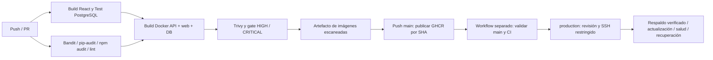

# GitHub Actions CI/CD — MediNet PAB

Estado de revisión: 30-10-2026. Responsable de continuación: Matías Gubelin.
Esta guía reemplaza las instrucciones anteriores de despliegue mediante runner
self-hosted. No se instaló ningún runner ni se realizaron operaciones AWS.

## 1. Arquitectura y estado comprobado



| Estado | Evidencia |
|---|---|
| Implementado | CI y CD separados; versiones fijadas; gates; publicación por SHA; entrega SSH y recuperación |
| Verificado localmente | 76 pruebas sin omisiones en PostgreSQL real; migraciones antes/después; seed idempotente; compilación React y tres imágenes; escáneres y linters; construcción desde copia de archivos publicables sin .env ni .env.runtime |
| Verificado en GitHub | [Ejecución 41089671930](https://github.com/claudiopioEnfasis/medinet-pab/actions/runs/41089671930), commit `add85a09a03fd0fa9f5410ea4e252e09540b3f67`: build, tests, seguridad y GHCR exitosos; EC2 omitido |
| Pendiente | Commit/push autorizado de estos cambios y ejecución remota del **nuevo** workflow; protección efectiva de main/production; preparación EC2, HTTPS y despliegue real |

La ejecución remota citada corresponde a la versión anterior; no acredita los
cambios locales actuales. No declarar CI/CD completamente operativo hasta probar
esta versión en GitHub y una entrega efectiva en EC2.

## 2. Build y eventos

[CI](../.github/workflows/ci-cd.yml): push en cualquier rama, PR dirigido a main y
activación manual. Python 3.12, Node 22, Ubuntu 24.04; cachés pip/npm separadas.
`npm ci` respeta el lockfile. Dependencias Python fijadas en requirements;
la resolución transitiva se audita, aunque no constituye un lockfile con hashes.
Dockerfiles fijan sus bases y construyen las tres imágenes reales del proyecto.

Las acciones checkout/setup-python/setup-node se fijan a SHA verificados de v7;
login-action v3 y upload/download-artifact v4 también usan SHA. Trivy, actionlint
y ShellCheck se fijan por digest. Actualizar versiones mediante PR, revisando
release oficial y volviendo a ejecutar controles. No sustituir digest por latest.
Las imágenes se escanean y guardan como un único artefacto con SHA-256; publicación
carga **ese mismo archivo**, sin reconstruir después de los controles.

## 3. Test: base temporal y fallo ante omisiones

El job construye PostgreSQL 17 del repositorio y arranca un contenedor temporal
con tmpfs y puerto accesible solo en loopback. Es un servicio de pruebas creado
con Docker, no la base local ni un volumen persistente. Credenciales aleatorias
se generan en cada ejecución y se enmascaran; no se lee el archivo .env local.

Orden: validar destino `medinet_ci`/`ci_user` en loopback → migrar Alembic →
`alembic check` → suite completa con JUnit → gate obligatorio → comprobar esquema
migrado → cargar seed dos veces sin duplicados. El seed estándar genera 12
cirugías; las 13 existentes en la instalación de demostración incluyen otra
operación y no deben eliminarse para igualar este número.

La suite cubre JWT, roles, pabellones, cirugías, disponibilidad triple, conflictos,
concurrencia PostgreSQL, bloqueo de login, grants mínimos, migraciones y seed.
[Gate](../scripts/ci_checks.py) exige casos críticos por nombre y rechaza cualquier
skip, error, fallo o informe vacío. Un fallo de pytest también bloquea el job.
Los ensayos de concurrencia usan esquemas aislados y conservan el esquema público
migrado para comprobarlo después. Nunca apuntar TEST_DATABASE_URL a datos reales.
Los seis ensayos de entrega son **simulaciones de comandos Docker/SSH**, no una
prueba de despliegue EC2. Las pruebas de navegador de escritura son un procedimiento
separado contra una copia ficticia; no se ejecutan sobre producción desde CI.

JUnit se redacta antes de subirlo para retirar URL/credenciales CI. Reportes de
pruebas y seguridad se conservan 14 días; imágenes escaneadas, 3 días. No subir
backups, archivos privados ni logs de configuración. El contenedor temporal se
detiene incluso cuando las pruebas fallan.

## 4. Security Scan y política

Se añadió Gitleaks 8.30.1 por digest para historial completo disponible y árbol
actual, sin supresiones añadidas y con redacción total. Bloquea la publicación
ante hallazgos. El nuevo gate requiere validación remota tras push autorizado.
Ver [auditoría de publicación](AUDITORIA_PUBLICACION_GITHUB.md) para alcance y
pendientes de GHCR; esta incorporación no habilita CD.

| Control | Versión / alcance | Condición de bloqueo |
|---|---|---|
| Bandit | 1.9.4; app y scripts | Cualquier hallazgo según severidad/confianza predeterminadas, sin exclusiones añadidas |
| pip-audit | 2.10.1; runtime, desarrollo, navegador y herramientas de seguridad | Cualquier vulnerabilidad conocida |
| npm audit | npm de Node 22; todas las dependencias, incluidas dev | HIGH o CRITICAL; LOW/MODERATE permanecen visibles |
| Trivy | 0.76.1 por digest; API, web y PostgreSQL | HIGH o CRITICAL, también sin parche; JSON inválido también falla |
| actionlint / ShellCheck | Imágenes por digest en CI | Errores YAML, expresiones o shell |

[Herramientas Python](../requirements-security.txt) fijadas; no usar ignore-CVE,
ignore-unfixed ni continue-on-error para aprobar artificialmente. Trivy informa
todas las severidades; MEDIUM/LOW deben registrarse y revisarse aunque no bloqueen.
Una excepción futura requiere justificación, responsable y vencimiento en un PR.
En esta revisión no se agregaron supresiones ni se identificaron vulnerabilidades
nuevas en Bandit/pip-audit/npm. Trivy también reportó cero vulnerabilidades de
cualquier severidad en las tres imágenes locales el 30-10-2026. Los resultados de
imágenes se conservan como
informes privados; la evidencia resumida se publica sin secretos.

## 5. Publicación GHCR y permisos

Solo push a main publica después de todos los gates. Prefijos calculados en
minúsculas: `ghcr.io/<propietario>/<repositorio>-api`, `-web`, `-db`; etiquetas
`sha-<SHA completo>`. No se despliega mediante latest. Mantener historial de tags
para recuperar una versión anterior; restringir escrituras en los paquetes.

GITHUB_TOKEN automático: contents:read por defecto; packages:write únicamente en
publicación; packages:read en entrega; actions:read solo para verificar releases.
No se necesita PAT para las ejecuciones normales. Vincular paquetes al repositorio
y permitir acceso Actions en configuración GHCR, especialmente paquetes privados.
El token se entrega por stdin a SSH, usa Docker config temporal en EC2 y se elimina
al finalizar. Nunca activar trazas shell ni imprimir variables o Docker config.

Los PR no publican ni reciben secretos de producción. No se utiliza
pull_request_target. El workflow de CD no descarga ni ejecuta código/artefactos
provenientes de un PR. Solo entrega un SHA actual de main con CI push exitoso del
mismo repositorio. Mantener control de cambios sobre workflows y scripts operativos.

## 6. GitHub: configuración todavía necesaria

| Nombre | Tipo y ubicación | Uso |
|---|---|---|
| ENABLE_EC2_DEPLOY | Variable repositorio; inicialmente ausente/false | Habilitar CD solo al terminar preparación |
| EC2_SECURITY_REVIEWED | Variable repositorio; inicialmente ausente/false | Confirmar revisión del acceso y protección |
| production | Environment | Revisores requeridos, impedir autoaprobación y restringir a main |
| EC2_HOST | Secret del Environment | DNS/IP vigente de EC2 |
| EC2_USER | Secret del Environment | Cuenta dedicada de entrega |
| EC2_SSH_PRIVATE_KEY | Secret del Environment | Clave dedicada a comando forzado |
| EC2_KNOWN_HOSTS | Secret del Environment | Host key validada por canal administrativo confiable |
| EC2_PORT | Variable repo/Environment; 22 por defecto | Puerto SSH validado |
| GITHUB_TOKEN | Automático por job | GHCR y lectura de metadatos; no crearlo manualmente |

**Limitación real de la cuenta:** repositorio privado; consulta a la protección de
main devolvió HTTP 403 indicando que requiere GitHub Pro o repositorio público.
No se modificó el plan ni la visibilidad. La consulta de Environments no devolvió
ninguno. Las protecciones/revisores de Environments privados dependen del plan:
verificar que estén efectivamente disponibles antes de habilitar CD. Un bloque
`environment: production` en YAML y el nombre main por sí solos **no garantizan
aprobación**. Ambas variables de activación estaban ausentes durante esta revisión.

Configurar protección de main con PR aprobado y checks obligatorios cuando el plan
lo permita. Si no está disponible, mantener CD deshabilitado y utilizar una ventana
manual revisada con el procedimiento del host; no presentar ese mecanismo como
aprobación automática impuesta por GitHub. No cambiar visibilidad sin autorización.

## 7. AWS Academy: preparación administrativa, sin ejecutar todavía

Se elige runner **efímero hospedado por GitHub + SSH restringido**, evitando instalar
un runner persistente en EC2. No requiere access key, secret key ni session token
AWS; la sesión Academy solo se utiliza administrativamente para preparar/encender
la instancia. Cuando termine el laboratorio, revisar IP/DNS y conectividad antes
de reintentar. Tener acceso SSH no crea ni enciende recursos AWS.

Un runner self-hosted con Docker ejecutaría código del repositorio en un host con
acceso equivalente a root y persistencia entre jobs. No se configuró. La alternativa
SSH también requiere evaluar el privilegio Docker: una cuenta dedicada y comando
forzado reducen superficie, pero no convierten el acceso Docker en bajo privilegio.

Preparación por Matías:

1. Learner Lab activo, EC2 Linux AMD64 con Docker Engine, Compose v2 moderno,
   Bash, Python3, curl, gzip, coreutils y flock. Disco persistente y RAM suficiente
   para restaurar el backup de comprobación en tmpfs; actualizar host y reloj.
2. Security Groups: SSH desde red administrativa o salida CI controlada; runners
   hospedados tienen IP dinámica, por lo que evaluar VPN/bastión/salida fija antes
   de habilitar entrega. No abrir SSH a todo Internet para resolverlo. No exponer
   5432, 8000 ni 3000. TLS mediante proxy en host a loopback:3000; 443 y, si aplica,
   80 para redirección/ACME. El propietario informa que DuckDNS y HTTPS ya funcionan;
   conservar el Nginx y certificados existentes. Esta preparación no los modifica.
3. Preparar `/opt/medinet-pab` y copiar de forma revisada compose.prod.yaml con su nombre original. Conservar deploy/deploy.sh,
   deploy/dispatch.sh y scripts/backup.sh en esas mismas rutas, protegidos de escritura por
   la cuenta SSH (propietario administrador). Esa cuenta tampoco debe poder
   sustituir los directorios padre, scripts o composición. Dar acceso solo al
   estado privado necesario y evaluar explícitamente su acceso al daemon Docker.
4. Crear .env privado 0600 **solo si no existe**, con credenciales robustas nuevas
   y JWT; seguir entrega técnica para migraciones iniciales, carga ficticia y
   scripts/provision_runtime.sh. No copiar secretos locales ni sobrescribir
   archivos existentes. La API usa .env.runtime 0600 con rol restringido;
   mantenimiento usa el rol administrativo. Primer bootstrap es manual, revisado,
   con backup verificable antes de tocar roles existentes.
5. Crear .deployment (0700) y current.env (0600) como datos, con estas tres claves:

   ```dotenv
   IMAGE_PREFIX=ghcr.io/propietario/repositorio
   IMAGE_TAG=sha_<reemplazar_por_formato_sha-guion-y-40-hex>
   POSTGRES_IMAGE_TAG=sha_<reemplazar_por_formato_sha-guion-y-40-hex>
   ```

   Los valores anteriores son marcadores deliberadamente inválidos: usar etiquetas
   reales `sha-` seguidas de 40 hexadecimales de una publicación aprobada. Etiqueta
   DB separada conserva su ciclo de mantenimiento. Para el bootstrap exportar
   únicamente esas tres variables no secretas y usar compose.prod.yaml; iniciar DB,
   migrar, provisionar rol y levantar API/web. Verificar datos, salud y coincidencia
   de imagen DB antes de registrar el release inicial. No hacer down ni reemplazar
   un volumen preexistente. Descargar inicialmente GHCR mediante autenticación
   privada de duración limitada y revocarla al terminar.
6. En authorized_keys de la cuenta dedicada configurar la clave pública con:

   ```text
   restrict,command="/opt/medinet-pab/deploy/dispatch.sh" <clave-publica-dedicada>
   ```

   Verificar OpenSSH compatible, sin shell arbitrario, PTY ni forwarding. Validar
   huella del host por canal confiable; no confiar automáticamente en ssh-keyscan.
   El dispatcher acepta exclusivamente `deploy <40-hex>` y dos líneas privadas
   por stdin con usuario/token GHCR. Probar permisos y comando antes de habilitar.
7. Respaldo externo cifrado, política de retención, restauración ensayada,
   monitorización y procedimiento para reiniciar laboratorio/instancia. No incluir
   backups, claves ni .deployment en Git, imágenes o artefactos Actions.

## 8. Despliegue y recuperación

[CD](../.github/workflows/deploy-ec2.yml) se activa tras CI exitoso de push main o
manualmente desde main indicando SHA completo. Requiere las dos variables true,
SHA igual al main actual y CI exitoso de ese SHA; luego Environment production.
Los despliegues se serializan y no se cancelan automáticamente a mitad de entrega.

[Script](../deploy/deploy.sh): validar configuración privada y salud inicial →
comprobar etiqueta DB → descargar solo API/web/mantenimiento → comparar head de
Alembic con esquema existente → detener escritores API/web → backup con checksum,
restauración aislada y comparación → mantenimiento y grants → levantar API/web
sin recrear DB → esperar healthchecks y readiness → guardar previous.env y
actualizar current.env únicamente al aprobar salud. No modifica .env, roles
administrativos, contraseña ni volumen DB. La reaplicación de grants ocurre
únicamente después del respaldo verificado.

**Migraciones nuevas:** si el head difiere, el CD falla antes de detener servicios.
Requieren ventana administrativa aprobada, backup y revisión de compatibilidad;
no ejecutar downgrade automático ni restaurar sobre datos nuevos.

Ante fallo tras detener servicios, si el esquema sigue igual se vuelve al release
registrado anterior y se comprueba salud. Si cambia el esquema o falla recuperación,
se informa intervención administrativa y se preserva el respaldo. No se garantiza
recuperación de cualquier fallo de infraestructura. Un rollback manual posterior
requiere revisión: recuperar tags anteriores desde previous.env y ejecutar el
script protegido con ese SHA desde consola administrativa, comprobar salud y datos;
no modificar DBtag ni restaurar datos automáticamente. Este flujo está cubierto
por simulaciones locales, pendiente de ensayo real en EC2.

Verificación posterior: `docker compose ps`, readiness en
`http://127.0.0.1:3000/api/health/ready`, interfaz/login/roles, Swagger a través de
`/api/docs`, conteos ficticios esperados y acceso externo HTTPS. Verificar que DB
mantenga contenedor/volumen y que current.env coincida con SHA aprobado. No volcar
variables secretas en consola ni logs.

## 9. VS Code, evidencias y diagnóstico

Extensión instalada comprobada: `github.vscode-github-actions` 0.32.3. Se abrió el
workflow en VS Code. Desde vista GitHub Actions, actualizar explorador, seleccionar
workflow/run y abrir jobs/logs. La extensión ofrece navegación y validación del
editor; este agente no tiene una API para accionar su interfaz. Las ejecuciones
remotas se consultaron mediante `gh` autenticado, sin lanzar runs ni publicar.

Después de push autorizado: verificar nuevo CI en Actions, revisar todos los jobs,
descargar reportes y confirmar etiquetas GHCR SHA. Comparar SHA de ejecución con
commit entregado. No basta con un indicador verde de una versión anterior.
Evidencia resumida local: [JSON](evidencias/github-actions-cicd.json). Logs privados
reproducibles bajo backups/cicd-v06 no se versionan ni se suben como artefactos.

Comandos de verificación de una copia limpia:

```bash
python -m pip install -r requirements-dev.txt -r requirements-security.txt
# Solo con PostgreSQL desechable y TEST_DATABASE_URL configurado:
python -m scripts.ci_checks validate-db
DATABASE_URL="$TEST_DATABASE_URL" python -m scripts.migrate
python -m pytest -q --junitxml=reports/pytest.xml
python -m scripts.ci_checks tests reports/pytest.xml
DATABASE_URL="$TEST_DATABASE_URL" python -m alembic check
# Frontend con Node 22: npm ci, npm run build, npm audit --audit-level=high
# Los comandos Docker/lint/Trivy exactos y digests constan en el workflow.
```

| Problema | Diagnóstico / corrección |
|---|---|
| Tests omitidos o PostgreSQL ausente | Gate debe fallar; revisar destino temporal y readiness, no desactivar tests |
| Dependencia vulnerable | Revisar advisory y actualizar versión compatible; repetir suite y scans |
| GHCR denied | Revisar vínculo paquete/repositorio y permissions del job; no imprimir token |
| CD omitido | Revisar ambas variables; main actual, origen push y nombre CI; omisión no significa despliegue |
| Environment/protección 403 | Verificar plan; mantener CD deshabilitado hasta resolver controles |
| SSH host key cambió | Confirmar huella de instancia por canal confiable antes de actualizar secret |
| SSH timeout | Lab/EC2 activo, DNS/IP actual, SG y salida CI; no desactivar comprobaciones |
| Migración nueva bloqueada | Ventana manual con aprobación, respaldo y compatibilidad |
| Fallo de salud | Revisar logs sin secretos y estado rollback; no borrar volumen |

Fuentes oficiales: [extensión](https://github.com/github/vscode-github-actions),
[seguridad Actions](https://docs.github.com/en/actions/reference/security/secure-use),
[Environments y planes](https://docs.github.com/en/actions/how-tos/deploy/configure-and-manage-deployments/manage-environments).
Para la rúbrica, adjuntar ejecución del nuevo SHA, reportes de gates, GHCR por SHA
y, solo cuando exista, evidencia de EC2 saludable y ensayo de recuperación.

## 10. Continuación sobre EC2 existente

Para la instalación ya operativa en https://medinet-pab.duckdns.org, seguir
[ACTIVACION_CD_EC2.md](ACTIVACION_CD_EC2.md). El script usa exclusivamente
compose.prod.yaml y scripts/backup.sh en el checkout del servidor. No copiar la
composición a compose.yaml ni reinstalar/provisionar una base ya existente.
El workflow separado verifica explícitamente publicación GHCR exitosa y salud
HTTPS antes/después de SSH. Mantener ENABLE_EC2_DEPLOY y EC2_SECURITY_REVIEWED
false o ausentes hasta aprobación explícita. Los estados históricos de esta guía
no constituyen verificación actual de AWS.
